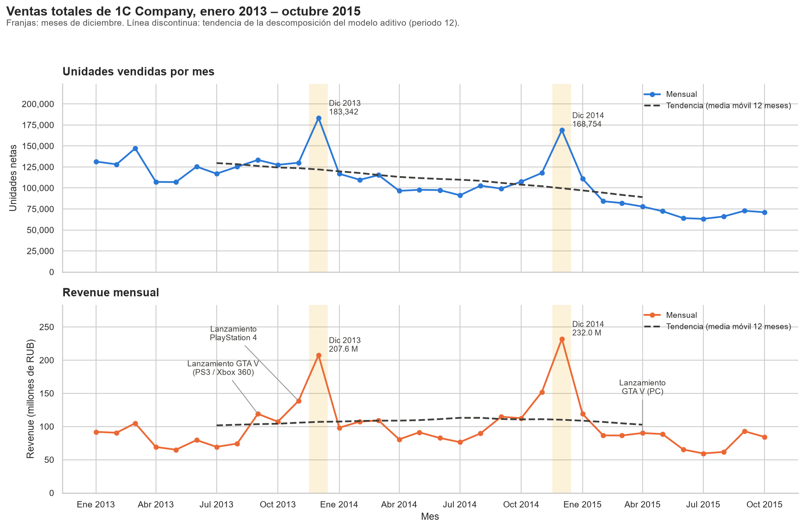
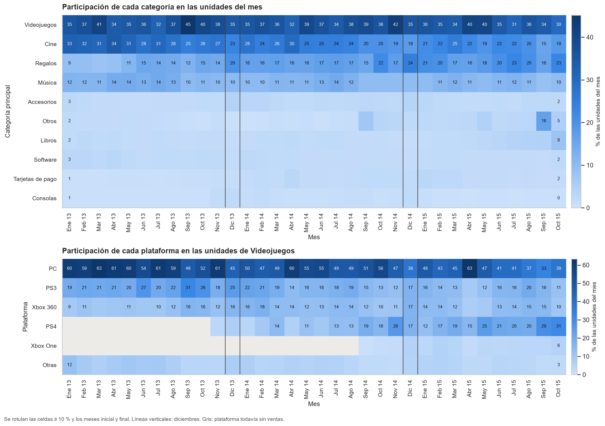
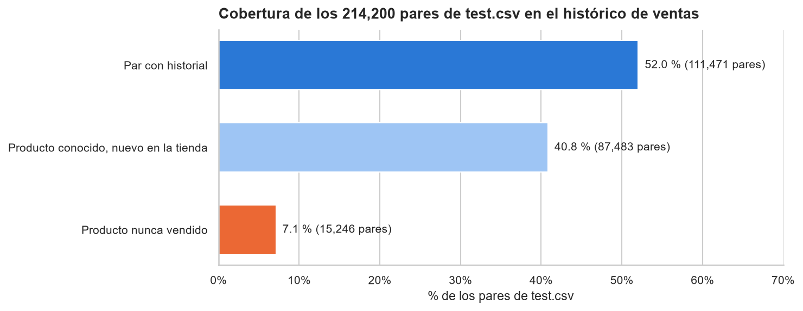

# Predict Future Sales — Análisis exploratorio de datos

<a target="_blank" href="https://cookiecutter-data-science.drivendata.org/">
    
</a>

Análisis exploratorio (EDA) de las ventas diarias de **1C Company**, una cadena rusa de software,
videojuegos y entretenimiento, como preparación para pronosticar las ventas mensuales de cada par
tienda-producto en **noviembre de 2015**. Proyecto del curso de Product Development de la maestría en
Business Intelligence.

## Datos

Los datos provienen de la competencia de Kaggle
[Predict Future Sales](https://www.kaggle.com/competitions/competitive-data-science-predict-future-sales).

| Archivo | Contenido |
|---|---|
| `sales_train.csv` | Ventas diarias por tienda y producto, enero 2013 – octubre 2015 (2,935,849 registros) |
| `items.csv` | Catálogo de productos (22,170) |
| `item_categories.csv` | Catálogo de categorías (84) |
| `shops.csv` | Catálogo de tiendas (60) |
| `test.csv` | 214,200 pares tienda-producto a pronosticar para noviembre de 2015 |

Los CSV no se incluyen en el repositorio (`data/` está en `.gitignore`). Para descargarlos:

1. Acepta las reglas de la competencia en Kaggle.
2. Descárgalos con la [CLI de Kaggle](https://github.com/Kaggle/kaggle-api) (requiere tu token en
   `~/.kaggle/kaggle.json`) o desde la pestaña *Data* de la competencia:

   ```bash
   kaggle competitions download -c competitive-data-science-predict-future-sales -p data/raw
   unzip data/raw/competitive-data-science-predict-future-sales.zip -d data/raw
   ```

3. Comprueba que los cinco archivos quedan directamente en `data/raw/`. Esa carpeta no se modifica nunca:
   los datos intermedios se generan en `data/interim/`.

## Entorno

El proyecto usa Python 3.11 con paquetes de conda-forge y OpenBLAS.

**Opción recomendada: conda**

```bash
conda env create -f environment.yml
conda activate env_future_sales
python -m ipykernel install --user --name env_future_sales --display-name "Python (env_future_sales)"
```

**Alternativa: pip**

```bash
python -m venv .venv
.venv\Scripts\activate          # Windows; en Linux/macOS: source .venv/bin/activate
pip install -r requirements.txt
```

`requirements.txt` fija las versiones exactas, agrupadas por categoría, e instala el módulo del proyecto en
modo editable (`-e .`).

## Estructura del proyecto

```
├── data
│   ├── raw            <- CSV originales de Kaggle (no se versionan ni se modifican)
│   └── interim        <- Datos intermedios generados por el notebook (Parquet)
├── notebooks
│   └── 01_exploratory_data_analysis.ipynb   <- Notebook principal del EDA
├── reports
│   └── figures        <- Figuras clave del EDA (PNG a 150 dpi) y tabla resumen de ACF/PACF
├── predict_future_sales   <- Módulo Python del proyecto (plantilla cookiecutter)
├── environment.yml    <- Entorno conda (env_future_sales)
├── requirements.txt   <- Dependencias con versiones exactas
├── pyproject.toml     <- Metadatos del paquete y configuración de ruff
└── CLAUDE.md          <- Convenciones de trabajo del proyecto
```

## Cómo ejecutar el notebook

Abre `notebooks/01_exploratory_data_analysis.ipynb` en JupyterLab o VS Code con el kernel
**Python (env_future_sales)** y ejecuta todas las celdas. También puede ejecutarse completo desde la
terminal, guardando las salidas:

```bash
python -m nbconvert --to notebook --execute --inplace notebooks/01_exploratory_data_analysis.ipynb
```

La ejecución completa tarda unos minutos y genera:

- `data/interim/sales_train_clean.parquet`: ventas limpias (sección 4).
- `data/interim/sales_enriched.parquet`: ventas limpias con revenue, categoría principal, ciudad y tipo de
  tienda (sección 5).
- Las figuras de `reports/figures/` (secciones 8, 9 y 10).

El notebook sigue las 10 secciones del enunciado: contexto, comprensión inicial, validación de estructura,
valores faltantes y duplicados, análisis descriptivo, exploración temporal, comparación entre tiendas y
productos, visualizaciones clave, ACF/PACF e insights.

## Principales hallazgos

1. **Datos limpios y consistentes.** No hay nulos ni días faltantes. Solo hubo que eliminar 6 duplicados,
   imputar 1 precio inválido y unificar 3 pares de tiendas repetidas (0→57, 1→58 y 11→10).
2. **El volumen cae y los ingresos se sostienen.** Las unidades de enero a octubre caen un 17.2 % en 2014 y
   un 26.1 % en 2015, mientras el revenue sube un 10.5 % en 2014 y baja un 13.3 % en 2015.
3. **Estacionalidad de fin de año.** Diciembre está un 57.9 % por encima de la tendencia y noviembre un
   9.2 %. Noviembre superó a octubre en los dos años con datos.
4. **Los lanzamientos mueven el negocio.** GTA V, la PlayStation 4 y The Witcher 3 generan los picos de
   revenue, y la PS4 pasa a representar el 20.9 % de las unidades de videojuegos en 2015.
5. **Ventas concentradas.** El 17.8 % de los productos genera el 80 % de las unidades, y Moscú concentra el
   33.3 % del revenue.
6. **El mes anterior es el mejor predictor.** La autocorrelación de rezago 1 va de 0.44 a 0.77 en las
   series mensuales. El rezago 12 solo es significativo en series agregadas.
7. **La mitad de `test.csv` no tiene historial propio.** El 52.0 % de los pares vendió alguna vez, el
   40.8 % son productos nuevos para la tienda y el 7.1 % son productos nunca vendidos. Las 42 tiendas de
   `test.csv` están activas en octubre de 2015.







## Próximos pasos

Con base en el EDA, la etapa de modelado debe:

- construir la grilla mensual tienda-producto con el objetivo recortado a [0, 20];
- generar rezagos (1, 2, 3 y 12 a nivel agregado), la antigüedad del producto y variables de tienda y
  categoría;
- excluir las tiendas de evento 9 y 20 del entrenamiento;
- validar de forma temporal (por ejemplo, entrenar hasta septiembre de 2015 y validar en octubre).

Autor: Luis Manuel Cruz — Maestría en BI, Product Development
